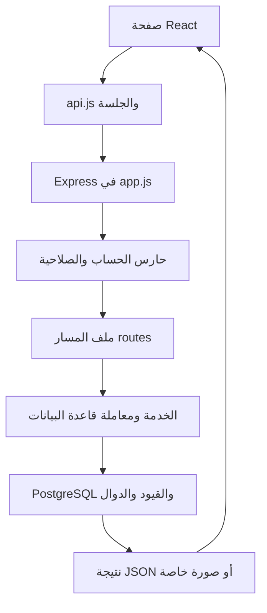

# دليل قراءة أكواد مزاد ليبيا

هذا الدليل يربط التعليقات العربية داخل الملفات بوظائف المنصة. أضيف شرح إلى 137 ملفًا من ملفات الواجهة والخلفية وقاعدة البيانات والتشغيل والاختبارات والنشر، مع توضيح أن الملفات المؤرشفة لا تعمل ضمن React الحالي. التعليقات تشرح مسؤولية الملف والدوال والمسارات والقرارات المهمة؛ لا تحتاج كل عملية إسناد بسيطة إلى إعادة وصفها بالكلمات.

## من أين تبدأ؟

1. اقرأ `frontend/src/main.jsx` لفهم تركيب المظهر والموجّه والجلسة والإشعارات.
2. انتقل إلى `frontend/src/App.jsx` لمعرفة الصفحات العامة والمحمية، ثم `routes.js` لعناوينها.
3. اختر ميزة داخل `frontend/src/features`، وتابع طلباتها عبر `frontend/src/api.js` إلى ملفها في `backend/src/routes`.
4. اقرأ `backend/src/app.js` لمعرفة ترتيب استقبال الطلب والحماية والجلسة والمسارات والأخطاء، و`server.js` لبدء الخادم والعامل الدوري.
5. اقرأ الخدمات داخل `backend/src/services` لفهم المعاملات المالية، وملفات SQL لفهم القيود التي تطبق حتى لو تغيرت الواجهة.



## طريقة قراءة الواجهة

| الجزء                     | وظيفته في المشروع                                                                                    |
| ------------------------- | ---------------------------------------------------------------------------------------------------- |
| `useState`                | يحتفظ ببيانات الصفحة أو المدخلات أو حالة التحميل والخطأ، ويعيد رسم الواجهة عند التغيير.              |
| `useEffect`               | ينفذ التحميل الأول أو التحديث الدوري أو الاشتراك في أحداث المتصفح، ويزيل الاشتراك عند مغادرة الصفحة. |
| `useCallback`             | يثبت مرجع دالة تستخدمها الاشتراكات أو المؤقتات مع إعادة إنشائها عند تغير اعتمادها.                   |
| `useMemo`                 | يعيد حساب نتيجة مثل مرشحات السيارات عندما تتغير البيانات المرتبطة بها.                               |
| `useRef`                  | يحفظ مرجعًا لا يحتاج إلى إعادة رسم، مثل رقم آخر طلب أو مرجع عملية الشحن أو علم بقاء الصفحة.          |
| `Context`                 | يشارك الجلسة أو الإشعارات أو المظهر بين الصفحات دون تمريرها عبر كل مكون وسيط.                        |
| `Link / Navigate / Route` | التنقل داخل React، والتحويل بين المسارات، وربط الرابط بالمكون الذي يعرضه.                            |
| `FormData`                | يجمع الحقول والملفات في طلب multipart، وهو المستخدم للتسجيل بالجواز وإضافة السيارة ومستنداتها.       |

الدوال مثل `load` و`refresh` تقرأ البيانات من الخادم. الدوال مثل `submit` و`pay` و`review` تنفذ إجراءً ثم تعيد قراءة الحالة الفعلية. حالات `busy` تمنع تكرار الضغط أثناء الانتظار. أرقام الطلبات وأعلام `alive` تمنع رد شبكة قديمًا من استبدال بيانات صفحة أحدث.

مكونات الواجهة تعرض المعلومات وتساعد الإدخال. إخفاء زر أو حساب الحد الأدنى داخل React لا يمنح صلاحية ولا يكفي لحماية المزايدة؛ الخلفية وقاعدة البيانات تعيدان التحقق عند تنفيذ الطلب.

## طريقة قراءة الخلفية

| الجزء                               | وظيفته في المشروع                                                                        |
| ----------------------------------- | ---------------------------------------------------------------------------------------- |
| `app.get/post/patch`                | تعريف مسار HTTP؛ الطريقة والرابط يحددان نوع الطلب الذي ينفذه.                            |
| `req.body / req.params / req.query` | بيانات النموذج، ومعرفات الرابط، وخيارات الاستعلام مثل صفحة المستخدمين.                   |
| `requireRole`                       | فحص نشاط الحساب وإصدار جلسة الدخول والدور والصلاحية من قاعدة البيانات.                   |
| `pool.query`                        | استعلام مستقل عبر مجموعة اتصالات PostgreSQL المشتركة.                                    |
| `pool.connect` ثم `client.query`    | حجز اتصال واحد لتنفيذ خطوات المعاملة على الاتصال نفسه.                                   |
| `BEGIN / COMMIT / ROLLBACK`         | بدء المعاملة واعتمادها أو التراجع عنها كي لا يبقى خصم بلا إجراء مقابل أو سجل ناقص.       |
| `FOR UPDATE`                        | قفل صف حتى تنتهي المعاملة؛ يستخدم لتنسيق المزايدة والإغلاق والخصم والتعديل المتزامن.     |
| `$1, $2...`                         | تمرير القيم منفصلة عن نص SQL، بدل تركيب مدخلات المستخدم داخل الاستعلام.                  |
| `next(error)`                       | تمرير الخطأ لمعالج الأخطاء المركزي الذي يحدد الاستجابة المناسبة ويخفي التفاصيل الداخلية. |
| `finally`                           | تحرير اتصال قاعدة البيانات أو تنظيف مورد سواء نجحت العملية أم فشلت.                      |

## تتبع وظائف المنصة

### التسجيل والجواز والجلسة

`RegisterPage.jsx` يجمع البيانات وصورة الجواز، ثم يرسلها إلى `routes/auth.js`. يستقبل `passportUpload` الصورة في مجلد خاص، ويفحصها `validateImage`. حفظ الحساب وربط صورته يحدثان في معاملة واحدة. بعد النجاح يحفظ الخادم الجلسة في `user_sessions` ويجدد `AuthContext` بيانات الحساب.

`/api/me` يعيد الاسم والصلاحيات وحالة وجود الجواز دون مسار الصورة. لا تفتح الصورة عبر `/uploads`؛ الإدارة تستخدم `routes/ownership.js` الذي يفحص صلاحيتها في كل طلب. تفاصيل السياسة في [سياسة الحساب والعرض](account-policy.md).

### عرض السيارة وتعديلها والرسوم

`SubmitCarPage.jsx` يخدم الإضافة والتعديل. الحقل `images` للصور العامة و`ownership_documents` لأوراق الملكية الخاصة. في التعديل تحدد `keep_image_ids` الصور الموجودة التي يجب الاحتفاظ بها. `routes/cars.js` يقفل السيارة ويتأكد من ملكيتها وعدم وجود مزاد مفتوح، ثم يعيدها للمراجعة. لا تحذف الملفات القديمة من القرص قبل نجاح تعديل قاعدة البيانات.

`AdminReviewPage.jsx` يرسل قرار الإدارة مع نسخة المستندات `ownership_revision`. أوراق الملكية اختيارية؛ يبقى الاعتماد أو الرفض قرارًا صريحًا للمدير مع المستندات أو بدونها. يقفل `reviewCar` الطلب ويفحص النسخة ثم يستدعي `chargeListingFee` داخل معاملة المراجعة. يخصم أول اعتماد 10 د.ل من الرصيد المتاح فقط. قيمة `listing_fee_amount = null` تعني أن التسوية الأولى لم تنفذ؛ الصفر قيمة إعفاء أو تسوية قائمة، فلا يجوز اعتباره طلب خصم جديد.

يفصل التحديث `017_notification_audiences.sql` إشعارات `user` و`admin` ويصنف الإشعارات الإدارية السابقة دون حذفها. مسارات `/api/notifications` للحساب فقط، و`/api/admin/notifications` للإدارة مع حارس `requireRole('admin')`. القراءة والعدادات مستقلان لكل نوع، وصفحة `/admin/notifications` وروابط الإدارة محمية بصلاحية المدير. روابط الإشعارات إلى `/admin` تُصنف إداريًا تلقائيًا عند الكتابة.

التعديل قبل وجود مزاد يعيد المراجعة دون محو تسوية الرسوم السابقة، لذلك لا تتكرر الرسوم عند إعادة الاعتماد. السيارات المباعة أو التي لديها مزاد مجدول أو نشط لا تقبل هذا التعديل.

### جدولة المزاد والمزايدة

`AdminAuctionsPage.jsx` يجمع تاريخ وساعة البداية والنهاية. `schedule.js` يحول إدخال ليبيا إلى UTC قبل إرساله. `dateTime` يعرض الموعد بتوقيت ليبيا، و`Countdown` يعوض فرق ساعة الجهاز لأغراض العرض.

`BidPanel.jsx` يجلب المزاد والعروض وملخص المحفظة. عند التأكيد، ينتقل الطلب عبر `features/auctions/api.js` إلى `backend/src/routes/auctions.js`. إدراج العرض يشغل `fn_validate_bid`، وتعريفه النهائي في التحديث 009: يقفل المزاد، ويتحقق من حالته والمالك والمزايد والزيادة والوقت، ويقفل المحافظ بترتيب ثابت، ويفحص المتاح ويغير الحجز، ثم يعيد فحص الوقت ويطبق التمديد. قواعد المنافسة في [آلية المزاد](auction-rules.md).

### الإغلاق والفاتورة والضمان

العامل في `jobs/closeAuctions.js` يختار المزادات المنتهية ويستدعي `closeAuction`. تستخدم الإدارة الخدمة نفسها للإغلاق الاحتياطي. الإغلاق يحدد أعلى عرض مستوفٍ لحد البيع؛ ينشئ فاتورة عند الفوز أو يفك الحجز عند عدم البيع.

`services/sales.js` ينفذ إجراءات المعاملة داخل `processSale`. ترتيب الأقفال هو المزاد ثم الفاتورة ثم محافظ الطرفين بترتيب المعرف. يستخدم وقت قاعدة البيانات بعد انتظار الأقفال لتقرير انتهاء مهلة الدفع.

| الحالة                | ما يحدث بعدها                                                         |
| --------------------- | --------------------------------------------------------------------- |
| `awaiting_payment`    | المشتري يسدد قبل المهلة، أو تنتهي المهلة ويُلغى الفوز ويُفك الحجز.    |
| `awaiting_handover`   | المبلغ مدفوع في الضمان؛ يسجل البائع التسليم.                          |
| `handed_over`         | يؤكد المشتري الاستلام ليُصرف الضمان للبائع.                           |
| `disputed`            | يتوقف الإتمام وصرف الضمان حتى تعالج الإدارة الاعتراض.                 |
| `completed`           | اكتمل الاستلام والتسوية؛ لا يتيح هذا المسار إلغاءً آليًا بعد الصرف.   |
| `cancelled / expired` | معاملة مغلقة؛ يُرد الضمان أو يُفك الحجز وفق ما إذا كان السداد قد حدث. |

سجل `invoice_events` يحفظ الإجراءات ويولد إشعاراتها. إعادة طلب الدفع أو الاستلام الناجح لا تكرر الأثر المالي. السداد اليدوي لا يولد رصيد محفظة، وإلغاء معاملة مسددة يدويًا يحتاج تأكيد معالجة الرد خارج المنصة.

### الصلاحيات والمظهر والإشعارات

`AdminUsersPage.jsx` يعرض خانات `can_list` و`can_bid` ودور الإدارة. الخلفية تفحص الفاعل تحت قفل، وتسجل القرار السابق والجديد، وتزيد `auth_version` وتنهي جلسات المستهدف عند التغيير. المستخدم يقرأ صلاحياته في `SettingsPage.jsx`، وتبقى وظائف تسوية معاملاته القائمة متاحة حتى لو منعت الإدارة تقديم عروض أو سيارات جديدة.

المظهر يبدأ من `public/theme-init.js` قبل رسم React. يدير `features/theme/theme.js` اختيار المستخدم أو الجهاز ويزامنه بين التبويبات. `ThemeContext` يربطه بالمكونات، بينما `theme.css` يحدد الألوان الفعلية. الإشعارات تأتي من سجل قاعدة البيانات، ويجددها `NotificationsContext` كل 15 ثانية ويحدث عداد غير المقروء.

## قراءة قاعدة البيانات

`schema.sql` هو نقطة إنشاء قاعدة فارغة، وليس وصفًا كاملًا لكل التحديثات الحالية منفردًا. بعده تنفذ ملفات `migrations` بترتيب أرقامها. تعريف دالة في تحديث لاحق قد يحل محل تعريفها الأول؛ لذلك ارجع إلى 009 للمزايدة الممولة، و011 لقيود المحفظة، و012 لدورة البيع والمستندات، و013 للجوازات والصلاحيات والرسوم.

`CHECK` يفرض شروط القيم، و`FOREIGN KEY` يربط السجل بأصله، و`UNIQUE` يمنع التكرار، و`INDEX` يخدم البحث والترتيب. `TRIGGER` يشغل التحقق أو الإشعار داخل المعاملة عند تغير السجل. بعض قيود تغطية المحفظة مؤجلة حتى اعتماد المعاملة، لأن خطوات صحيحة متعددة قد تغير الرصيد والحجز بالتتابع قبل الوصول للحالة النهائية المتسقة.

## الملفات التي لا تقبل تعليقات داخلية

| الملف                             | وظيفته وسبب شرحِه هنا                                                                              |
| --------------------------------- | -------------------------------------------------------------------------------------------------- |
| `package.json` في الجذر           | يجمع أوامر تشغيل المشروع والبناء والترحيل والاختبارات والتنسيق والنسخ، واعتماديات أدوات التطوير.   |
| `frontend/package.json`           | اعتماديات React وVite وTailwind وأوامر الواجهة.                                                    |
| `backend/package.json`            | اعتماديات Express وPostgreSQL والصور والجلسات، وأوامر الخلفية والترحيل وتهيئة التطوير.             |
| ملفات `package-lock.json` الثلاثة | نسخ الاعتماديات الدقيقة والتحقق منها لإعادة تثبيت البيئة نفسها؛ تولدها npm.                        |
| `.prettierrc.json`                | قواعد التنسيق الموحدة مثل عرض السطر والاقتباس والفاصلة النهائية.                                   |
| `shared/car-models.json`          | بيانات الماركات ومصفوفة موديلات كل ماركة، مشتركة بين الواجهة والخلفية؛ ملف بيانات وليس منطق تنفيذ. |

صيغة JSON لا تقبل تعليقات، لذلك بقيت صالحة كما هي. ملفات الصور والمرفقات والنسخ ومخرجات البناء والاعتماديات وحزم المهارات الخارجية ليست كود تطبيق نضيف له تعليقات. الملفات المؤرشفة مشروحة باعتبارها مرجعًا قديمًا، ولا تحدد سلوك الموقع الحالي.

## التحقق من التعديلات

أُخذت مقارنة محلية لهيكل JavaScript/JSX قبل إضافة التعليقات وبعدها، مع تجاهل مواقع الأسطر والتعليقات فقط. قورنت قواعد CSS ومحتويات SQL وملفات التشغيل بعد استبعاد التعليقات. الهدف إثبات أن الشرح لم يبدل منطق التنفيذ أو بيانات المشروع. يستخدم البناء واختبار الخلفية الحاليان كفحص إضافي؛ لا تحتاج التعليقات إلى اختبارات سلوك جديدة خاصة بها.

للفحص المعتاد من مجلد المشروع:

```powershell
npm.cmd test
npm.cmd run build
npm.cmd run format:check
```

## فهرس الملفات المشروحة

الأسماء التالية روابط للملفات، والوصف يبين وظيفة كل ملف. التعليقات داخل الملف تضيف تفاصيل الدوال والمسارات والقرارات التي يحتاجها قارئ الكود.

### مدخل الواجهة والإعدادات

| الملف                                                         | الوظيفة                                                                                                    |
| ------------------------------------------------------------- | ---------------------------------------------------------------------------------------------------------- |
| [frontend/index.html](../frontend/index.html)                 | قالب صفحة React العربية من اليمين لليسار؛ يحمّل المظهر مبكرًا والخط ونقطة تشغيل التطبيق.                   |
| [frontend/postcss.config.js](../frontend/postcss.config.js)   | يربط معالجة CSS بإضافتي Tailwind وAutoprefixer أثناء التطوير والبناء.                                      |
| [frontend/src/api.js](../frontend/src/api.js)                 | طبقة الاتصال بالخلفية؛ ترسل جلسة المستخدم، وتوحد أخطاء الشبكة، وتنسق الأسعار والأسماء والتواريخ.           |
| [frontend/src/App.jsx](../frontend/src/App.jsx)               | شجرة صفحات الموقع؛ تفصل الصفحات العامة وصفحات الحساب والإدارة، وتحول الروابط القديمة إلى المسارات الموحدة. |
| [frontend/src/main.jsx](../frontend/src/main.jsx)             | نقطة بدء React؛ تركّب المظهر والجلسة والإشعارات والموجّه حول التطبيق وتحمّل التنسيقات.                     |
| [frontend/src/routes.js](../frontend/src/routes.js)           | مرجع عناوين الصفحات ووجهات الدخول؛ يتحقق من رابط العودة حتى يبقى التنقل داخل الموقع.                       |
| [frontend/tailwind.config.js](../frontend/tailwind.config.js) | يحدد الملفات التي يفحصها Tailwind لاستخراج أصناف التنسيق وإعداد امتدادات التصميم.                          |
| [frontend/vite.config.js](../frontend/vite.config.js)         | إعداد خادم تطوير React والبناء؛ يثبت المنفذ ويمرر API والصور للخلفية ويكشف هوية خدمة التطوير.              |

### مكونات الواجهة وبياناتها وتنسيقها

| الملف                                                                                           | الوظيفة                                                                                        |
| ----------------------------------------------------------------------------------------------- | ---------------------------------------------------------------------------------------------- |
| [frontend/public/theme-init.js](../frontend/public/theme-init.js)                               | يسترجع المظهر قبل رسم الصفحة لتقليل ومضة الألوان، ويدعم منع الوصول للتخزين المحلي.             |
| [frontend/src/components/AppErrorBoundary.jsx](../frontend/src/components/AppErrorBoundary.jsx) | حاجز أخطاء العرض في React؛ يعرض وسيلة للتعافي إذا فشل رسم جزء من التطبيق.                      |
| [frontend/src/components/Brand.jsx](../frontend/src/components/Brand.jsx)                       | شعار مزاد ليبيا ورابط الصفحة الرئيسية؛ يدعم العرض فوق الخلفيات الفاتحة والداكنة.               |
| [frontend/src/components/CarCard.jsx](../frontend/src/components/CarCard.jsx)                   | بطاقة إعلان السيارة؛ تعرض الصورة والسعر وحالة المزاد والروابط إلى التفاصيل والمزايدة.          |
| [frontend/src/components/Feedback.jsx](../frontend/src/components/Feedback.jsx)                 | عناصر مشتركة لرسائل النجاح والخطأ والتحميل والقوائم الفارغة بدل تكرارها في الصفحات.            |
| [frontend/src/components/Footer.jsx](../frontend/src/components/Footer.jsx)                     | تذييل الموقع؛ يجمع روابط الحساب والمساعدة وقواعد المزاد ومعلومات المنصة.                       |
| [frontend/src/components/SiteHeader.jsx](../frontend/src/components/SiteHeader.jsx)             | التنقل الرئيسي والقائمة على الهاتف؛ يظهر روابط الحساب والإدارة وفق الجلسة ويعالج تسجيل الخروج. |
| [frontend/src/components/ThemeSwitcher.jsx](../frontend/src/components/ThemeSwitcher.jsx)       | اختيار المظهر الفاتح أو الداكن أو مظهر الجهاز من مخزن المظهر المشترك.                          |
| [frontend/src/data/carMakes.js](../frontend/src/data/carMakes.js)                               | كتالوج الماركات وتسمياتها العربية والبدائل؛ يوحد كتابة الماركة ويجهز خيارات البحث.             |
| [frontend/src/data/carModels.js](../frontend/src/data/carModels.js)                             | يربط كتالوج الموديلات المشترك بالماركة المختارة، مع تسميات وبدائل عربية وإدخال يدوي.           |
| [frontend/src/layouts/AdminLayout.jsx](../frontend/src/layouts/AdminLayout.jsx)                 | الإطار المشترك لصفحات الإدارة وروابطها؛ حراسة صلاحية الدخول موجودة في الموجّه والخلفية.        |
| [frontend/src/styles/base.css](../frontend/src/styles/base.css)                                 | التنسيق العام للموقع وصفحات التصفح والدخول والنماذج، مع قواعد الشاشات الصغيرة والطباعة.        |
| [frontend/src/styles/theme.css](../frontend/src/styles/theme.css)                               | متغيرات وألوان المظهر الداكن وضبط عناصر النماذج والطباعة بما يتوافق مع اختيار المظهر.          |
| [frontend/src/styles/workspace.css](../frontend/src/styles/workspace.css)                       | تنسيقات صفحات الحساب والإدارة والمزايدة والمرفقات والمحفظة والصلاحيات والمكونات الداخلية.      |

### ميزات الواجهة

| الملف                                                                                                                   | الوظيفة                                                                                                |
| ----------------------------------------------------------------------------------------------------------------------- | ------------------------------------------------------------------------------------------------------ |
| [frontend/src/features/account/AccountPage.jsx](../frontend/src/features/account/AccountPage.jsx)                       | مدخل وظائف الحساب الموحد؛ يعرض روابط السيارات والمزايدات والمحفظة والفواتير والإعدادات والإدارة.       |
| [frontend/src/features/account/InvoicesPage.jsx](../frontend/src/features/account/InvoicesPage.jsx)                     | فواتير المستخدم كطرف بيع أو شراء؛ السداد والتسليم والاستلام والاعتراض ومتابعة سجل المعاملة.            |
| [frontend/src/features/account/MyBidsPage.jsx](../frontend/src/features/account/MyBidsPage.jsx)                         | المزادات التي شارك فيها الحساب؛ يوضح موقع العرض والفوز وحالة الفاتورة بعد الإغلاق.                     |
| [frontend/src/features/account/MyCarsPage.jsx](../frontend/src/features/account/MyCarsPage.jsx)                         | طلبات سيارات المستخدم وحالتها؛ يظهر التعديل قبل وجود مزاد مفتوح والرسوم المسددة وروابط المزادات.       |
| [frontend/src/features/account/NotificationsContext.jsx](../frontend/src/features/account/NotificationsContext.jsx)     | مخزن إشعارات المستخدم وعدد غير المقروء؛ يجددها دوريًا ويمنع تسرب رد حساب سابق بعد تبديل الجلسة.        |
| [frontend/src/features/account/NotificationsPage.jsx](../frontend/src/features/account/NotificationsPage.jsx)           | قائمة إشعارات الحساب وروابطها؛ تسمح بتحديد إشعار أو القائمة كمقروءة.                                   |
| [frontend/src/features/account/paymentReference.js](../frontend/src/features/account/paymentReference.js)               | يولد معرّف عملية شحن فريدًا لكي يتعرف الخادم على إعادة المحاولة ولا يكرر إضافة الرصيد.                 |
| [frontend/src/features/account/SaleHistory.jsx](../frontend/src/features/account/SaleHistory.jsx)                       | تحميل سجل أحداث الفاتورة عند الطلب؛ يربط السجل بنسخة بيانات المعاملة حتى لا يعرض أحداثًا قديمة.        |
| [frontend/src/features/account/saleLabels.js](../frontend/src/features/account/saleLabels.js)                           | ترجمة حالات البيع والضمان إلى عبارات عربية موحدة بين واجهتي المستخدم والإدارة.                         |
| [frontend/src/features/account/SettingsPage.jsx](../frontend/src/features/account/SettingsPage.jsx)                     | تعديل الاسم وبيانات التواصل وكلمة المرور، وعرض صلاحيات الحساب وحالة إرفاق الجواز دون تعديلها.          |
| [frontend/src/features/account/SubmitCarPage.jsx](../frontend/src/features/account/SubmitCarPage.jsx)                   | إضافة السيارة أو تعديلها؛ يجهز بياناتها وصورها وأوراق الملكية الخاصة ويرسلها للمراجعة مع توضيح الرسوم. |
| [frontend/src/features/account/WalletPage.jsx](../frontend/src/features/account/WalletPage.jsx)                         | عرض رصيد المحفظة والمتاح والمحجوز والضمان، مع الشحن وسجل الحركات ورسوم عرض السيارات.                   |
| [frontend/src/features/admin/pages/AdminAuctionsPage.jsx](../frontend/src/features/admin/pages/AdminAuctionsPage.jsx)   | جدولة المزادات بتوقيت ليبيا وتحديد الأسعار ومهلة السداد، مع متابعة المزادات وإلغاء الموعد أو الإغلاق.  |
| [frontend/src/features/admin/pages/AdminDashboardPage.jsx](../frontend/src/features/admin/pages/AdminDashboardPage.jsx) | ملخص مهام الإدارة والمبالغ؛ الطلبات والمزادات والفواتير والاعتراضات والضمان ورسوم العرض المحصلة.       |
| [frontend/src/features/admin/pages/AdminInvoicesPage.jsx](../frontend/src/features/admin/pages/AdminInvoicesPage.jsx)   | معالجة الفواتير إداريًا؛ السداد اليدوي وقرارات الاعتراض والإلغاء والاسترداد وسجل الإجراءات.            |
| [frontend/src/features/admin/pages/AdminReviewPage.jsx](../frontend/src/features/admin/pages/AdminReviewPage.jsx)       | مراجعة السيارة وصورها وأوراقها الاختيارية؛ يتطلب الاعتماد قرار المدير ونسخة الطلب الحالية.             |
| [frontend/src/features/admin/pages/AdminUsersPage.jsx](../frontend/src/features/admin/pages/AdminUsersPage.jsx)         | إدارة الحسابات على صفحات؛ البحث في المحمل وفتح الجواز الخاص وحفظ الصلاحيات وإيقاف الحساب أو تفعيله.    |
| [frontend/src/features/auctions/api.js](../frontend/src/features/auctions/api.js)                                       | طلبات المزايدة مجمعة هنا: قراءة المزاد والعروض وإرسال عرض جديد إلى الخادم.                             |
| [frontend/src/features/auctions/AuctionPage.jsx](../frontend/src/features/auctions/AuctionPage.jsx)                     | يقرأ معرّف المزاد من الرابط ويركب لوحة المزايدة، مع إعادة ضبطها عند الانتقال لمزاد آخر.                |
| [frontend/src/features/auctions/AuctionRulesPage.jsx](../frontend/src/features/auctions/AuctionRulesPage.jsx)           | شرح خطوات العرض والمزايدة والحجز والسداد والتسليم والاعتراض ورسوم عرض السيارة للمستخدم.                |
| [frontend/src/features/auctions/BidPanel.jsx](../frontend/src/features/auctions/BidPanel.jsx)                           | لوحة المزاد التفاعلية؛ تحدّث السعر والعروض والمحفظة دوريًا وترسل العرض وتعرض المهلة وحالة المزاد.      |
| [frontend/src/features/auctions/Countdown.jsx](../frontend/src/features/auctions/Countdown.jsx)                         | عداد المدة المتبقية؛ يحسب فرق ساعة الجهاز عن وقت الخادم ثم يعرض الأيام والساعات والثواني.              |
| [frontend/src/features/auctions/schedule.js](../frontend/src/features/auctions/schedule.js)                             | تحويل تاريخ وساعة الجدولة من توقيت ليبيا إلى UTC، ورفض التاريخ غير الصالح وحساب مدة المزاد.            |
| [frontend/src/features/auth/AuthContext.jsx](../frontend/src/features/auth/AuthContext.jsx)                             | مصدر جلسة المستخدم داخل React؛ يجلب الحساب الحالي ويحدّثه بعد الدخول والخروج وتغير الصلاحيات.          |
| [frontend/src/features/auth/pages/LoginPage.jsx](../frontend/src/features/auth/pages/LoginPage.jsx)                     | نموذج الدخول للحساب أو للإدارة؛ يحفظ وجهة العودة ويزامن بيانات الجلسة بعد نجاح الدخول.                 |
| [frontend/src/features/auth/pages/RegisterPage.jsx](../frontend/src/features/auth/pages/RegisterPage.jsx)               | إنشاء حساب موحد مع صورة جواز إلزامية؛ يرسل البيانات والمرفق عبر multipart ثم يفتح الحساب.              |
| [frontend/src/features/auth/RequireRole.jsx](../frontend/src/features/auth/RequireRole.jsx)                             | حراسة صفحات الواجهة؛ تنتظر فحص الجلسة ثم تعيد الزائر للدخول أو تعرض سبب منع الوصول.                    |
| [frontend/src/features/cars/pages/CarDetailsPage.jsx](../frontend/src/features/cars/pages/CarDetailsPage.jsx)           | تفاصيل السيارة ومعرض صورها ومعلومات المزاد؛ لا يطلب المستندات الخاصة أو يعرضها.                        |
| [frontend/src/features/cars/pages/HomePage.jsx](../frontend/src/features/cars/pages/HomePage.jsx)                       | تصفح السيارات المعتمدة والبحث فيها حسب الماركة والموديل والنص المدخل.                                  |
| [frontend/src/features/theme/theme.js](../frontend/src/features/theme/theme.js)                                         | مخزن المظهر المستقل عن React؛ يطبق الألوان ويتابع إعداد الجهاز وتغييرات التخزين بين التبويبات.         |
| [frontend/src/features/theme/ThemeContext.jsx](../frontend/src/features/theme/ThemeContext.jsx)                         | يربط مخزن المظهر بمكونات React عبر useSyncExternalStore حتى تتحدث كل الأزرار معًا.                     |

### الخلفية ومسارات API والخدمات

| الملف                                                                           | الوظيفة                                                                                                       |
| ------------------------------------------------------------------------------- | ------------------------------------------------------------------------------------------------------------- |
| [backend/server.js](../backend/server.js)                                       | يشغّل Express والعامل الدوري على المنفذ المحدد، ويغلق اتصالات HTTP وقاعدة البيانات عند إيقاف الخادم.          |
| [backend/src/app.js](../backend/src/app.js)                                     | تجميع Express؛ رؤوس الحماية والجلسات والملفات العامة ومسارات API وواجهة الإنتاج ومعالجة الأخطاء.              |
| [backend/src/config.js](../backend/src/config.js)                               | تحميل إعدادات البيئة وتوحيد منفذ الخادم ومدة الجلسة ومسارات الصور ونسخة الواجهة المبنية.                      |
| [backend/src/db.js](../backend/src/db.js)                                       | مجموعة اتصالات PostgreSQL المشتركة؛ تقرأ إعدادات البيئة وحدود الاتصال وتبلغ عن أخطاء المجموعة.                |
| [backend/src/jobs/closeAuctions.js](../backend/src/jobs/closeAuctions.js)       | عامل كل خمس ثوانٍ يغلق المزادات المنتهية وينهي مهلة الفواتير، ويمنع تداخل دورتي العمل في العملية نفسها.       |
| [backend/src/middleware/auth.js](../backend/src/middleware/auth.js)             | فحص الجلسة والأدوار وصلاحيات العرض والمزايدة من قاعدة البيانات، وحد محاولات الدخول والتسجيل.                  |
| [backend/src/middleware/requestLog.js](../backend/src/middleware/requestLog.js) | يمنح كل طلب معرّفًا ويسجل النتيجة والمدة دون طباعة كلمات المرور أو أجسام الطلبات.                             |
| [backend/src/middleware/uploads.js](../backend/src/middleware/uploads.js)       | استقبال صور السيارات والملكية والجواز في مسارات منفصلة؛ فحص نوع الصورة ومعالجتها وتنظيف الملفات.              |
| [backend/src/routes/account.js](../backend/src/routes/account.js)               | قوائم مزايدات المستخدم وفواتيره كطرف بيع أو شراء؛ يحد الاستعلام بكل حساب ولا يكشف فواتير الآخرين.             |
| [backend/src/routes/admin-users.js](../backend/src/routes/admin-users.js)       | إحصائيات الإدارة وقوائم الحسابات وتعديل صلاحياتها وحالتها، وإلغاء المزادات المستقبلية دون عروض.               |
| [backend/src/routes/admin.js](../backend/src/routes/admin.js)                   | مراجعة السيارات وجدولة المزادات وإغلاقها وقراءة بيانات الإدارة؛ يربط أول اعتماد بخصم رسوم العرض.              |
| [backend/src/routes/auctions.js](../backend/src/routes/auctions.js)             | قراءة بيانات المزاد والعروض العامة وإرسال المزايدة؛ يحول أخطاء قواعد البيانات إلى رسائل مفهومة.               |
| [backend/src/routes/auth.js](../backend/src/routes/auth.js)                     | مسارات الدخول والتسجيل بالجواز والجلسة الحالية والخروج؛ تحفظ كلمة المرور مشفرة وتمنع طلب الإدارة عند التسجيل. |
| [backend/src/routes/cars.js](../backend/src/routes/cars.js)                     | مسارات السيارات العامة والخاصة؛ إضافة الصور والمستندات وتعديل سيارة المالك وإعادتها للمراجعة بشكل ذري.        |
| [backend/src/routes/ownership.js](../backend/src/routes/ownership.js)           | تنزيل صور الملكية والجواز عبر فحص مدير نشط فقط، دون روابط عامة ومع منع التخزين المؤقت.                        |
| [backend/src/routes/profile.js](../backend/src/routes/profile.js)               | تعديل الملف وكلمة المرور وإدارة الإشعارات؛ يطلب كلمة المرور الحالية لتغيير بيانات التواصل.                    |
| [backend/src/routes/sales.js](../backend/src/routes/sales.js)                   | واجهة إجراءات دورة البيع؛ تربط صلاحيات البائع والمشتري والإدارة بخدمة السداد والتسليم والاعتراض.              |
| [backend/src/routes/wallet.js](../backend/src/routes/wallet.js)                 | سياسة رسوم العرض وقراءة المحفظة وشحنها وسداد فاتورة الفوز؛ يتحقق من قيمة المبلغ ومرجع العملية.                |
| [backend/src/services/auctions.js](../backend/src/services/auctions.js)         | إغلاق المزاد داخل معاملة وقفل سجله؛ اختيار أعلى عرض مستوفٍ لحد البيع وإنشاء فاتورة أو فك الحجز.               |
| [backend/src/services/listingFees.js](../backend/src/services/listingFees.js)   | خصم رسوم أول اعتماد للسيارة فقط؛ يحترم حجوزات العارض ويسجل الرسم والإشعار داخل معاملة المراجعة.               |
| [backend/src/services/sales.js](../backend/src/services/sales.js)               | آلة حالات البيع؛ تحفظ السداد في الضمان وتنفذ التسليم والاستلام والاعتراض والاسترداد وانتهاء المهلة ذريًا.     |
| [backend/src/services/wallet.js](../backend/src/services/wallet.js)             | قراءة متسقة للرصيد والحجوزات والضمان وسجل الحركات، وتنفيذ الشحن مرة واحدة لكل مرجع عملية.                     |
| [backend/src/sessionStore.js](../backend/src/sessionStore.js)                   | مخزن جلسات express-session في PostgreSQL بدل الذاكرة، مع انتهاء الصلاحية والتنظيف الدوري.                     |
| [backend/src/utils/carInput.js](../backend/src/utils/carInput.js)               | تنظيف بيانات السيارة وتوحيد الماركة والموديل والتحقق من الهيكل والسنة والمسافة والحالة.                       |
| [backend/src/utils/http.js](../backend/src/utils/http.js)                       | أدوات مشتركة للجلسات ورسائل الأخطاء والحقول النصية والأرقام الاختيارية بدل تكرارها في المسارات.               |
| [backend/src/utils/httpError.js](../backend/src/utils/httpError.js)             | ينشئ خطأ يحمل حالة HTTP ورسالة آمنة يمكن عرضها للمستخدم من معالج الأخطاء المركزي.                             |
| [backend/src/utils/money.js](../backend/src/utils/money.js)                     | يتحقق من المبلغ دون الاعتماد على حسابات الفاصلة العائمة، ويعيد سلسلة بثلاث خانات عشرية للمحفظة.               |
| [backend/src/utils/roles.js](../backend/src/utils/roles.js)                     | توحيد buyer وseller القديمين إلى user، واختيار الدور الرئيسي مع الحفاظ على صلاحية admin المنفصلة.             |

### قاعدة البيانات والتحديثات

| الملف                                                                                                                                               | الوظيفة                                                                                                   |
| --------------------------------------------------------------------------------------------------------------------------------------------------- | --------------------------------------------------------------------------------------------------------- |
| [backend/database/migrations/001_add_storage_key.sql](../backend/database/migrations/001_add_storage_key.sql)                                       | إضافة مفتاح تخزين صور السيارات لربط السجل بملفه المحلي وتمكين التنظيف الآمن.                              |
| [backend/database/migrations/002_backend_workflows.sql](../backend/database/migrations/002_backend_workflows.sql)                                   | إضافة مفتاح تخزين الصور وملاحظات المراجعة وجدول الجلسات وفهرس انتهاء الصلاحية.                            |
| [backend/database/migrations/003_notifications.sql](../backend/database/migrations/003_notifications.sql)                                           | جدول الإشعارات ودوال توليدها عند تغير حالة السيارة أو الفاتورة أو المزاد.                                 |
| [backend/database/migrations/004_active_seller_bidding.sql](../backend/database/migrations/004_active_seller_bidding.sql)                           | تشديد قبول المزايدات على سيارة معتمدة لمالك نشط، مع منع مزايدة البائع على سيارته.                         |
| [backend/database/migrations/005_account_versions.sql](../backend/database/migrations/005_account_versions.sql)                                     | إضافة رقم إصدار مصادقة للحساب حتى تُبطل الجلسات عند تغيير الأمان أو إيقاف المستخدم.                       |
| [backend/database/migrations/006_add_user_role.sql](../backend/database/migrations/006_add_user_role.sql)                                           | إضافة قيمة user للدور الموحد قبل تحويل الإسنادات القديمة في التحديث اللاحق.                               |
| [backend/database/migrations/007_unified_users.sql](../backend/database/migrations/007_unified_users.sql)                                           | دمج صلاحيات المشتري والبائع في user وتحديث الجلسات ودوال التحقق دون تغيير معرفات البيانات.                |
| [backend/database/migrations/008_demo_wallet.sql](../backend/database/migrations/008_demo_wallet.sql)                                               | إنشاء المحافظ والحجوزات وسجل الحركات وطرق السداد وإعداد التمديد، مع محافظ افتراضية للحسابات.              |
| [backend/database/migrations/009_funded_bidding.sql](../backend/database/migrations/009_funded_bidding.sql)                                         | قواعد المزايدة الممولة الذرية: قفل المزاد والمحافظ وفحص المتاح وتبديل الحجز وإعادة فحص الوقت والتمديد.    |
| [backend/database/migrations/010_wallet_notifications.sql](../backend/database/migrations/010_wallet_notifications.sql)                             | إشعارات السداد اليدوي والمحفظة؛ يستبدل التحديث 012 إشعاراتها بسجل أحداث دورة البيع.                       |
| [backend/database/migrations/011_wallet_guards.sql](../backend/database/migrations/011_wallet_guards.sql)                                           | منع تعديل سجل الحركات وفرض تغطية الرصيد للحجوزات عند اعتماد المعاملة.                                     |
| [backend/database/migrations/012_sale_lifecycle.sql](../backend/database/migrations/012_sale_lifecycle.sql)                                         | مهلة سداد الفوز وضمان المعاملة وسجل الأحداث وأوراق الملكية؛ يحافظ على التسويات السابقة عند التحديث.       |
| [backend/database/migrations/013_passports_permissions_listing_fees.sql](../backend/database/migrations/013_passports_permissions_listing_fees.sql) | الجوازات الخاصة وصلاحيات الحساب ورسوم أول اعتماد وسجل قرارات الإدارة، دون خصم بأثر رجعي.                  |
| [backend/database/schema.sql](../backend/database/schema.sql)                                                                                       | المخطط الأساسي لقاعدة جديدة فقط؛ ينشئ الأنواع والجداول والقيود والدوال، ثم تُطبق عليه التحديثات بالترتيب. |

### التشغيل والنشر والأدوات

| الملف                                                                   | الوظيفة                                                                                                         |
| ----------------------------------------------------------------------- | --------------------------------------------------------------------------------------------------------------- |
| [backend/scripts/backup.js](../backend/scripts/backup.js)               | نسخ قاعدة البيانات بصيغة pg_dump وملفات uploads وبيان الاستعادة؛ لا ينسخ أسرار ملف البيئة.                      |
| [backend/scripts/check-columns.js](../backend/scripts/check-columns.js) | أداة تشخيص تعرض أعمدة جداول قاعدة البيانات للتحقق من بنية البيئة الحالية.                                       |
| [backend/scripts/grant-admin.js](../backend/scripts/grant-admin.js)     | أداة سطر أوامر لمنح الإدارة لحساب موجود؛ لا تنشئ كلمة مرور جديدة ولا حساب مدير تلقائيًا.                        |
| [backend/scripts/init-db.js](../backend/scripts/init-db.js)             | تطبيق ملفات التحديث SQL بالترتيب على قاعدة مهيأة، دون إعادة إنشاء المخطط الأساسي فوق البيانات.                  |
| [backend/scripts/seed-seller.js](../backend/scripts/seed-seller.js)     | تهيئة حساب اختبار ببيانات ثابتة داخل السكربت؛ اتصال قاعدة البيانات يأتي من البيئة، وليس هذا مسار التسجيل العام. |
| [deploy/.env.example](../deploy/.env.example)                           | قالب إعداد نطاق الإنتاج وكلمات مرور الخدمات وسر الجلسة المستخدم في Docker Compose.                              |
| [deploy/backup.sh](../deploy/backup.sh)                                 | نسخ قاعدة الإنتاج وملفات الصور من وحدات تخزين Docker إلى مجلد نسخ مستقل.                                        |
| [deploy/Caddyfile](../deploy/Caddyfile)                                 | توجيه نطاق الإنتاج إلى التطبيق وإدارة HTTPS عبر Caddy وفق إعداد النطاق.                                         |
| [deploy/compose.yml](../deploy/compose.yml)                             | خدمات PostgreSQL والتطبيق وCaddy وأداة النسخ الاحتياطي، مع وحدات تخزين مستقلة للبيانات والصور والشهادات.        |
| [deploy/init-db.sh](../deploy/init-db.sh)                               | تهيئة قاعدة إنتاج جديدة وتطبيق المخطط والتحديثات ومنح مستخدم التطبيق الصلاحيات اللازمة.                         |
| [Dockerfile](../Dockerfile)                                             | بناء الواجهة في مرحلة مستقلة ثم تجهيز خادم الإنتاج بمتطلبات التشغيل فقط وتشغيله بمستخدم محدود.                  |
| [scripts/dev-services.js](../scripts/dev-services.js)                   | يفحص المنفذ وهوية خدمة التطوير لتمييز المشروع العامل عن تطبيق آخر قبل محاولة تشغيل نسخة إضافية.                 |
| [scripts/dev.js](../scripts/dev.js)                                     | مشغّل التطوير المشترك؛ يستخدم الخدمات القائمة أو يبدأ الناقص منها ويوقف فقط العمليات التي أنشأها.               |

### الاختبارات

| الملف                                                                                 | الوظيفة                                                                                               |
| ------------------------------------------------------------------------------------- | ----------------------------------------------------------------------------------------------------- |
| [backend/tests/account-policies.test.js](../backend/tests/account-policies.test.js)   | اختبار الجواز الخاص ورسوم الاعتماد المتزامن والتعديل والصلاحيات وإبطال الجلسات وحماية سجل القرارات.   |
| [backend/tests/car-models.test.js](../backend/tests/car-models.test.js)               | يتحقق من ربط الموديلات بالماركات وعدم فقد الخيارات المهمة مثل Hyundai Azera وAccent.                  |
| [backend/tests/dev-launcher.test.js](../backend/tests/dev-launcher.test.js)           | يتأكد أن المشغّل يعيد استخدام خدمة المشروع ويحترم التطبيق الآخر ولا يبدأ نسخة خلفية مكررة.            |
| [backend/tests/helpers/application.js](../backend/tests/helpers/application.js)       | بناء بيئة اختبار API مع مخطط PostgreSQL ومجلد صور مؤقتين وجلسات منفصلة، ثم تنظيفها بعد الحالة.        |
| [backend/tests/helpers/registration.js](../backend/tests/helpers/registration.js)     | يجهز طلب تسجيل اختباري بمرفق جواز اصطناعي حتى تستخدم الاختبارات عقد التسجيل الفعلي.                   |
| [backend/tests/ownership-uploads.test.js](../backend/tests/ownership-uploads.test.js) | اختبار صور JPEG وPNG وWebP على ويندوز؛ المعالجة والخصوصية والاستبدال وتنظيف المستندات القديمة.        |
| [backend/tests/sale-lifecycle.test.js](../backend/tests/sale-lifecycle.test.js)       | اختبار تكامل الخصوصية والمراجعة والمهلة والضمان والتسليم والاعتراض والاسترداد والمنافسة المتزامنة.    |
| [backend/tests/theme.test.js](../backend/tests/theme.test.js)                         | اختبار استعادة المظهر قبل الرسم ومتابعة الجهاز ومزامنة التبويبات والعمل دون تخزين محلي.               |
| [backend/tests/ui-preview.js](../backend/tests/ui-preview.js)                         | خادم واجهة اختباري مع حسابات وصور اصطناعية وأوامر تحكم في المهل والرسوم؛ ينظف بياناته عند الإنهاء.    |
| [backend/tests/unified-users.test.js](../backend/tests/unified-users.test.js)         | يعيد بناء مخطط قديم في بيئة معزولة ويتأكد أن دمج buyer وseller يحافظ على الحسابات والبيانات والإدارة. |
| [backend/tests/wallet-auctions.test.js](../backend/tests/wallet-auctions.test.js)     | اختبار ذري للشحن والحجوزات والرصيد المتاح والتمديد والإغلاق والتسوية دون تكرار مالي.                  |
| [backend/tests/workflows.test.js](../backend/tests/workflows.test.js)                 | اختبار دورة الحساب والسيارة والمراجعة والمزاد والمزايدة والفائز والفاتورة على بيانات معزولة.          |
| [frontend/e2e/account-policies.spec.js](../frontend/e2e/account-policies.spec.js)     | تجربة متصفح كاملة للتسجيل بالجواز ورسوم العرض مرة واحدة وتعديل السيارة وتغيير الصلاحيات.              |
| [frontend/e2e/application.js](../frontend/e2e/application.js)                         | تجهيز Playwright؛ يشغّل خادم المعاينة المؤقت ويقدم أدوات الدخول والمزايدة وفحص العرض والتنظيف.        |
| [frontend/e2e/sales.spec.js](../frontend/e2e/sales.spec.js)                           | تجارب الواجهة لدورة البيع والخصوصية وأحجام الشاشة والمظهر وانقطاع الاتصال والاعتراض وانتهاء المهلة.   |
| [frontend/e2e/schedule.spec.js](../frontend/e2e/schedule.spec.js)                     | يثبت أن إدخال موعد المزاد بتوقيت ليبيا يعطي التوقيت الصحيح حتى عندما يختلف توقيت جهاز المتصفح.        |
| [playwright.config.js](../playwright.config.js)                                       | إعداد اختبارات المتصفحات الثلاثة والتقارير ولقطات الفشل؛ تستخدم الاختبارات خادمًا مؤقتًا مستقلًا.     |

### إعدادات الملفات والأرشيف

| الملف                                                                       | الوظيفة                                                                                                         |
| --------------------------------------------------------------------------- | --------------------------------------------------------------------------------------------------------------- |
| [.dockerignore](../.dockerignore)                                           | استثناء بيانات التطوير والأسرار والصور والنسخ والتقارير من سياق بناء صورة الإنتاج.                              |
| [.gitattributes](../.gitattributes)                                         | إعداد نهايات الأسطر وخصائص الملفات حتى تعمل سكربتات النشر والنصوص عبر أنظمة التشغيل.                            |
| [.gitignore](../.gitignore)                                                 | استثناء الاعتماديات والمخرجات والأسرار والصور الخاصة والنسخ والتقارير من تتبع Git.                              |
| [.prettierignore](../.prettierignore)                                       | استثناء الملفات التي لا ينبغي إعادة تنسيقها آليًا، مثل المخرجات والاعتماديات والبيانات الخاصة.                  |
| [archive/legacy-frontend/app.js](../archive/legacy-frontend/app.js)         | واجهة JavaScript القديمة المحفوظة للرجوع فقط؛ لا تحملها صفحات React الحالية ولا تحدد سلوك المنصة.               |
| [archive/legacy-frontend/index.html](../archive/legacy-frontend/index.html) | قالب النموذج القديم المؤرشف؛ ليس نقطة دخول الواجهة الحالية ولا يُنشر ضمن بناء React.                            |
| [archive/legacy-frontend/styles.css](../archive/legacy-frontend/styles.css) | تنسيق النموذج القديم المؤرشف؛ تنسيقات الواجهة الفعلية موجودة في frontend/src/styles.                            |
| [archive/seed-seller-original.js](../archive/seed-seller-original.js)       | نسخة قديمة مؤرشفة لأداة تهيئة البائع؛ المرجع التشغيلي الحالي هو backend/scripts/seed-seller.js.                 |
| [backend/.env.example](../backend/.env.example)                             | قالب أسماء إعدادات الخادم وقاعدة البيانات والجلسة؛ القيم الفعلية تحفظ في ملف البيئة المحلي المستبعد من النشر.   |
| [backend/.gitignore](../backend/.gitignore)                                 | استثناء الملفات المحلية الحساسة أو المولدة الخاصة بالخلفية من تتبع Git.                                         |
| [frontend/.gitignore](../frontend/.gitignore)                               | استثناء الاعتماديات ومخرجات Vite وملفات التطوير المحلية من تتبع الواجهة.                                        |
| [seed-seller.js](../seed-seller.js)                                         | بقايا ملف قديم في الجذر لا تستخدمه أوامر المشروع؛ أداة تهيئة التطوير الفعلية في backend/scripts/seed-seller.js. |
