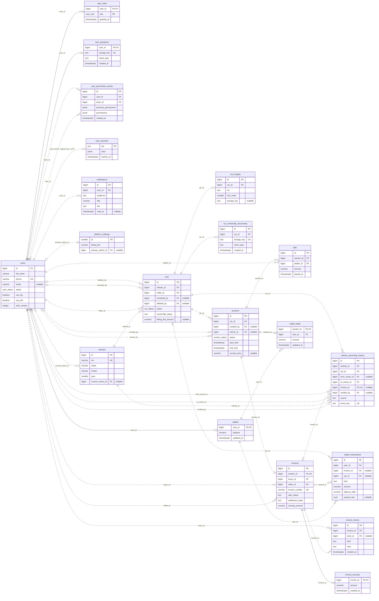

# جداول قاعدة بيانات مزاد ليبيا والعلاقات ومخطط ERD

تاريخ المراجعة 9 نوفمبر 2026. جرت مطابقة مخطط PostgreSQL الفعلي في public مع schema.sql وملفات التحديث حتى 019. تضم القاعدة 20 جدولًا و36 مفتاحًا خارجيًا.

## أسماء الجداول وتخصصاتها

| الجدول                      | التخصص                                                                                                                               | المفتاح الأساسي    | أهم الحقول                                                                                                   |
| --------------------------- | ------------------------------------------------------------------------------------------------------------------------------------ | ------------------ | ------------------------------------------------------------------------------------------------------------ |
| `users`                     | الحساب الموحد للمستخدم، بما يشمل بيانات التواصل وتجزئة كلمة المرور وحالة الحساب وصلاحيتي العرض والمزايدة.                            | `id`               | `full_name`، `phone`، `email`، `status`، `can_list`، `can_bid`، `auth_version`                               |
| `user_roles`                | الأدوار الممنوحة للحساب، مثل user للمستخدم الموحد وadmin للإدارة. يمكن للحساب امتلاك أكثر من دور.                                    | `user_id` + `role` | `granted_at`                                                                                                 |
| `user_passports`            | مرجع صورة جواز السفر الخاصة بالحساب ونوعها وتاريخ رفعها، مع صورة واحدة كحد أقصى لكل مستخدم.                                          | `user_id`          | `storage_key`، `mime_type`، `created_at`                                                                     |
| `user_permission_events`    | سجل ثابت لتغييرات الصلاحيات، يحدد الحساب المستهدف والمدير المنفذ والقيم السابقة والجديدة.                                            | `id`               | `user_id`، `actor_id`، `previous_permissions`، `permissions`، `created_at`                                   |
| `user_sessions`             | جلسات تسجيل الدخول الخاصة بـExpress، مع بيانات الجلسة بصيغة JSONB وتاريخ انتهاء صلاحيتها.                                            | `sid`              | `sess`، `expires_at`                                                                                         |
| `notifications`             | إشعارات الحساب ووقت قراءتها ورابط الإجراء. يميز audience بين إشعارات المستخدم وإشعارات الإدارة.                                      | `id`               | `user_id`، `audience`، `title`، `link`، `read_at`                                                            |
| `platform_settings`         | إعدادات المنصة المشتركة، وتشمل رسوم عرض السيارة وهوية المدير الرئيسي. يسمح القيد بسجل واحد معرفه 1.                                  | `id`               | `listing_fee`، `primary_admin_id`                                                                            |
| `vehicles`                  | الهوية الدائمة للمركبة برقم الهيكل VIN الفريد، مع بياناتها الأساسية ومالكها الحالي عبر عمليات البيع المتعاقبة.                       | `id`               | `vin`، `make`، `model`، `year`، `current_owner_id`                                                           |
| `cars`                      | إعلان عرض السيارة للبيع، ويشمل العارض وحالة المراجعة واعتماد الملكية ورسوم العرض وبيانات الحذف. يرتبط كل إعلان بمركبة دائمة.         | `id`               | `vehicle_id`، `seller_id`، `reviewed_by`، `deleted_by`، `status`، `ownership_status`، `listing_fee_amount`   |
| `car_images`                | صور إعلان السيارة العامة وروابطها وترتيب عرضها ومفاتيح تخزين ملفاتها.                                                                | `id`               | `car_id`، `url`، `sort_order`، `storage_key`                                                                 |
| `car_ownership_documents`   | مراجع صور مستندات الملكية المرتبطة بالإعلان، مع مفاتيح التخزين الخاصة وأنواع الصور.                                                  | `id`               | `car_id`، `storage_key`، `mime_type`، `created_at`                                                           |
| `vehicle_ownership_history` | سجل ثابت لتاريخ ملكية المركبة، يحفظ المالك السابق والجديد والإعلان والفاتورة إن وجدت والمدير الذي اعتمد الانتقال.                    | `id`               | `vehicle_id`، `car_id`، `from_owner_id`، `to_owner_id`، `invoice_id`، `verified_by`، `source`، `event_key`   |
| `auctions`                  | مزاد إعلان السيارة، بما يشمل الأسعار والحد الأدنى للزيادة والمواعيد والحالة والفائز وطريقة السداد والتمديد ومهلة الدفع.              | `id`               | `car_id`، `created_by`، `winner_id`، `status`، `start_time`، `end_time`، `current_price`                     |
| `bids`                      | العروض المالية المقدمة في المزاد، مع صاحب المزايدة وقيمتها ووقت تسجيلها. تبقى المزايدات محفوظة كسجل ثابت.                            | `id`               | `auction_id`، `bidder_id`، `amount`، `placed_at`                                                             |
| `invoices`                  | فاتورة الفوز بالبيع بين المشتري والبائع، مع قيمة الفوز ومهلة السداد وحالات الدفع والتسليم والضمان والاعتراض.                         | `id`               | `auction_id`، `buyer_id`، `seller_id`، `invoice_number`، `sale_status`، `settlement_state`، `winning_amount` |
| `invoice_events`            | سجل ثابت لأحداث المعاملة مثل السداد والتسليم والاستلام والاعتراض والإلغاء، مع الفاعل والملاحظة والتوقيت.                             | `id`               | `invoice_id`، `actor_id`، `kind`، `note`، `created_at`                                                       |
| `invoice_escrows`           | مبلغ السداد التجريبي المحفوظ في ضمان الفاتورة حتى اكتمال التسليم أو استرداده عند إلغاء المعاملة.                                     | `invoice_id`       | `amount`، `created_at`                                                                                       |
| `wallets`                   | المحفظة التجريبية للمستخدم ورصيدها. تنشأ تلقائيًا عند إنشاء الحساب، ويحسب المتاح بطرح الحجوزات.                                      | `user_id`          | `balance`، `updated_at`                                                                                      |
| `wallet_holds`              | حجز رصيد أعلى مزايدة في المزاد. يوجد حجز واحد كحد أقصى لكل مزاد، ويتبع محفظة المزايد الأعلى.                                         | `auction_id`       | `user_id`، `amount`، `updated_at`                                                                            |
| `wallet_transactions`       | دفتر الحركات المالية الثابت للمحفظة، مثل الشحن والسداد وحصيلة البيع والاسترداد ورسوم العرض، مع مراجع الفاتورة أو الإعلان عند الحاجة. | `id`               | `user_id`، `invoice_id`، `car_id`، `kind`، `amount`، `balance_after`، `request_key`                          |

## كيف تُقرأ العلاقات

PK هو المفتاح الأساسي الذي يميز السجل، وFK هو المفتاح الخارجي الذي يربطه بجدول آخر، وUK أو UQ يعني قيدًا فريدًا. تشير 0..1 إلى سجل اختياري واحد كحد أقصى، و0..N إلى صفر أو عدة سجلات.

في الجدول التالي يُقرأ الطرف الأيسر بوصفه عدد سجلات الأصل المسموح بها لكل سجل تابع، والطرف الأيمن بوصفه عدد السجلات التابعة المسموح بها لكل سجل أصل. اختيارية المفتاح الخارجي تعني أنه يقبل NULL. تعكس التعددية قيود القاعدة، بينما تنشئ إجراءات التطبيق بعض السجلات تلقائيًا مثل محفظة المستخدم.

| الأصل             | المرجع في الجدول التابع                   | التعددية     | قبول NULL في المرجع | عند حذف سجل الأصل فعليًا          |
| ----------------- | ----------------------------------------- | ------------ | ------------------- | --------------------------------- |
| `cars.id`         | `auctions.car_id`                         | 1 ↔ 0..N    | لا                  | RESTRICT يمنع الحذف عند وجود مرجع |
| `users.id`        | `auctions.created_by`                     | 0..1 ↔ 0..N | نعم                 | SET NULL يفرغ المرجع              |
| `users.id`        | `auctions.winner_id`                      | 0..1 ↔ 0..N | نعم                 | SET NULL يفرغ المرجع              |
| `auctions.id`     | `bids.auction_id`                         | 1 ↔ 0..N    | لا                  | RESTRICT يمنع الحذف عند وجود مرجع |
| `users.id`        | `bids.bidder_id`                          | 1 ↔ 0..N    | لا                  | RESTRICT يمنع الحذف عند وجود مرجع |
| `cars.id`         | `car_images.car_id`                       | 1 ↔ 0..N    | لا                  | CASCADE يحذف السجلات التابعة      |
| `cars.id`         | `car_ownership_documents.car_id`          | 1 ↔ 0..N    | لا                  | CASCADE يحذف السجلات التابعة      |
| `users.id`        | `cars.deleted_by`                         | 0..1 ↔ 0..N | نعم                 | RESTRICT يمنع الحذف عند وجود مرجع |
| `users.id`        | `cars.reviewed_by`                        | 0..1 ↔ 0..N | نعم                 | SET NULL يفرغ المرجع              |
| `users.id`        | `cars.seller_id`                          | 1 ↔ 0..N    | لا                  | RESTRICT يمنع الحذف عند وجود مرجع |
| `vehicles.id`     | `cars.vehicle_id`                         | 1 ↔ 0..N    | لا                  | RESTRICT يمنع الحذف عند وجود مرجع |
| `invoices.id`     | `invoice_escrows.invoice_id`              | 1 ↔ 0..1    | لا                  | RESTRICT يمنع الحذف عند وجود مرجع |
| `users.id`        | `invoice_events.actor_id`                 | 0..1 ↔ 0..N | نعم                 | RESTRICT يمنع الحذف عند وجود مرجع |
| `invoices.id`     | `invoice_events.invoice_id`               | 1 ↔ 0..N    | لا                  | RESTRICT يمنع الحذف عند وجود مرجع |
| `auctions.id`     | `invoices.auction_id`                     | 1 ↔ 0..1    | لا                  | RESTRICT يمنع الحذف عند وجود مرجع |
| `users.id`        | `invoices.buyer_id`                       | 1 ↔ 0..N    | لا                  | RESTRICT يمنع الحذف عند وجود مرجع |
| `users.id`        | `invoices.seller_id`                      | 1 ↔ 0..N    | لا                  | RESTRICT يمنع الحذف عند وجود مرجع |
| `users.id`        | `notifications.user_id`                   | 1 ↔ 0..N    | لا                  | CASCADE يحذف السجلات التابعة      |
| `users.id`        | `platform_settings.primary_admin_id`      | 0..1 ↔ 0..1 | نعم                 | RESTRICT يمنع الحذف عند وجود مرجع |
| `users.id`        | `user_passports.user_id`                  | 1 ↔ 0..1    | لا                  | CASCADE يحذف السجلات التابعة      |
| `users.id`        | `user_permission_events.actor_id`         | 1 ↔ 0..N    | لا                  | NO ACTION يمنع كسر المرجع         |
| `users.id`        | `user_permission_events.user_id`          | 1 ↔ 0..N    | لا                  | NO ACTION يمنع كسر المرجع         |
| `users.id`        | `user_roles.user_id`                      | 1 ↔ 0..N    | لا                  | CASCADE يحذف السجلات التابعة      |
| `cars.id`         | `vehicle_ownership_history.car_id`        | 1 ↔ 0..N    | لا                  | RESTRICT يمنع الحذف عند وجود مرجع |
| `users.id`        | `vehicle_ownership_history.from_owner_id` | 0..1 ↔ 0..N | نعم                 | RESTRICT يمنع الحذف عند وجود مرجع |
| `invoices.id`     | `vehicle_ownership_history.invoice_id`    | 0..1 ↔ 0..1 | نعم                 | RESTRICT يمنع الحذف عند وجود مرجع |
| `users.id`        | `vehicle_ownership_history.to_owner_id`   | 1 ↔ 0..N    | لا                  | RESTRICT يمنع الحذف عند وجود مرجع |
| `vehicles.id`     | `vehicle_ownership_history.vehicle_id`    | 1 ↔ 0..N    | لا                  | RESTRICT يمنع الحذف عند وجود مرجع |
| `users.id`        | `vehicle_ownership_history.verified_by`   | 0..1 ↔ 0..N | نعم                 | RESTRICT يمنع الحذف عند وجود مرجع |
| `users.id`        | `vehicles.current_owner_id`               | 0..1 ↔ 0..N | نعم                 | RESTRICT يمنع الحذف عند وجود مرجع |
| `auctions.id`     | `wallet_holds.auction_id`                 | 1 ↔ 0..1    | لا                  | RESTRICT يمنع الحذف عند وجود مرجع |
| `wallets.user_id` | `wallet_holds.user_id`                    | 1 ↔ 0..N    | لا                  | RESTRICT يمنع الحذف عند وجود مرجع |
| `cars.id`         | `wallet_transactions.car_id`              | 0..1 ↔ 0..N | نعم                 | RESTRICT يمنع الحذف عند وجود مرجع |
| `invoices.id`     | `wallet_transactions.invoice_id`          | 0..1 ↔ 0..N | نعم                 | RESTRICT يمنع الحذف عند وجود مرجع |
| `wallets.user_id` | `wallet_transactions.user_id`             | 1 ↔ 0..N    | لا                  | RESTRICT يمنع الحذف عند وجود مرجع |
| `users.id`        | `wallets.user_id`                         | 1 ↔ 0..1    | لا                  | RESTRICT يمنع الحذف عند وجود مرجع |

## علاقات وقواعد مهمة

- users هو الجدول المشترك للمستخدمين والمديرين. يحدد user_roles الأدوار، ويحفظ platform_settings.primary_admin_id هوية المدير الرئيسي.
- vehicles يحفظ هوية المركبة الفريدة بالـVIN، ويمكن أن ترتبط المركبة بإعلانات متعددة في cars عبر الزمن. يمنع الفهرس الجزئي وجود أكثر من إعلان واحد للمركبة في حالتي pending_review أو approved.
- إعلان cars واحد قد يمر بعدة مزادات، مع منع وجود أكثر من مزاد scheduled أو active للإعلان نفسه في الوقت نفسه.
- المزاد يقبل مزايدات متعددة، وقد ينتج عنه صفر أو فاتورة واحدة. يحفظ winner_id هوية الفائز عندما يوجد فائز.
- المستخدم قد يكون بائعًا في معاملة ومشتريًا أو مزايدًا في أخرى. seller_id وbuyer_id وbidder_id تشير جميعها إلى users بحسب الدور في العملية.
- user_roles يستخدم مفتاحًا مركبًا من user_id وrole. user_passports وwallets يستخدمان user_id مفتاحًا أساسيًا وخارجيًا معًا.
- wallet_holds يستخدم auction_id مفتاحًا أساسيًا، ولذلك لا يتجاوز الحجز سجلًا واحدًا لكل مزاد. invoice_escrows يستخدم invoice_id مفتاحًا أساسيًا للسبب نفسه.
- يرتبط سجل الملكية بفاتورة اختيارية وفريدة، ولذلك ترتبط الفاتورة بسجل انتقال ملكية واحد كحد أقصى. قد تنشأ سجلات ملكية أخرى من المراجعة دون فاتورة.
- user_sessions يرتبط بالمستخدم منطقيًا عبر userId داخل sess من نوع JSONB. لا يوجد عمود user_id أو قيد FK في هذا الجدول، وقد تُحفظ جلسة دون تسجيل دخول.
- platform_settings يسمح بسجل واحد ذي id=1، ولذلك لا يرتبط المستخدم بأكثر من سجل إعدادات واحد بصفته المدير الرئيسي، رغم عدم وجود UNIQUE مستقل على primary_admin_id.
- فصل إشعارات المستخدم والإدارة يعتمد notifications.audience، مع قيمة user أو admin في الجدول نفسه.
- الفهرس الجزئي ux_wallet_listing_fee يمنع تكرار حركة listing_fee للإعلان نفسه. يحفظ دفتر المحفظة أيضًا مراجع لعمليات الشحن والفواتير لمنع تكرار الأثر المالي.
- حجز المزايدة في wallet_holds والضمان المدفوع في invoice_escrows مرحلتان منفصلتان من دورة المعاملة.
- حذف الإعلان في الواجهة يغير حالته إلى deleted مع حفظ deleted_at وdeleted_by. إجراءات ON DELETE الموضحة أعلاه تخص الحذف الفعلي من SQL. تبقى سجلات الفواتير والدفع والملكية مرتبطة بالإعلان المؤرشف.
- سجلات المزايدات وحركات المحفظة وأحداث الفواتير والصلاحيات والملكية محمية من التعديل والحذف بواسطة دوال وقواعد القاعدة.

## مخطط ERD الكامل

[فتح مخطط SVG القابل للتكبير](database-erd.svg) · [فتح صورة PNG](database-erd.png) · [مصدر Mermaid](database-erd.mmd)

يعرض المخطط جميع الجداول وجميع علاقات FK، مع المفاتيح وبعض الحقول الأساسية لكل جدول. يمثل الخط الذهبي المتقطع في صورة SVG ارتباط الجلسة المنطقي فقط. في مصدر Mermaid تعني الخطوط المتصلة علاقات تعريفية تدخل فيها FK ضمن PK، وتعني الخطوط المتقطعة علاقات غير تعريفية. يحمل ارتباط الجلسة وصفًا صريحًا بأنه بلا FK.

## الملفات المرجعية

- [المخطط الأساسي](../backend/database/schema.sql)
- [تحديث المحافظ](../backend/database/migrations/008_demo_wallet.sql)
- [تحديث الفواتير والضمان والملكية](../backend/database/migrations/012_sale_lifecycle.sql)
- [تحديث الجوازات والصلاحيات والرسوم](../backend/database/migrations/013_passports_permissions_listing_fees.sql)
- [تحديث هوية المركبة وإعادة البيع](../backend/database/migrations/014_vehicle_identity_resale.sql)
- [المدير الرئيسي](../backend/database/migrations/016_primary_administrator.sql)
- [فصل الإشعارات](../backend/database/migrations/017_notification_audiences.sql)
- [أرشفة الإعلانات المحذوفة](../backend/database/migrations/018_deleted_listings.sql)
- [حذف البيانات القديمة ذات سنة تصنيع غير صالحة](../backend/database/migrations/019_delete_legacy_listings.sql)
